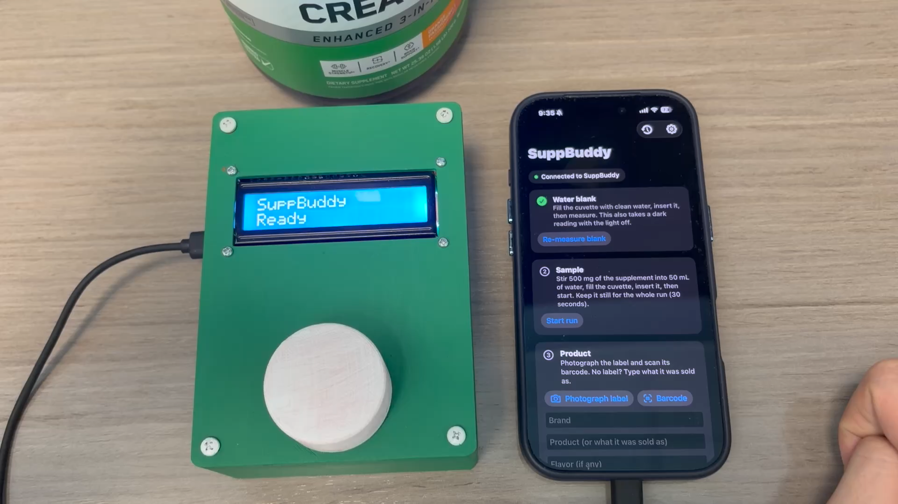
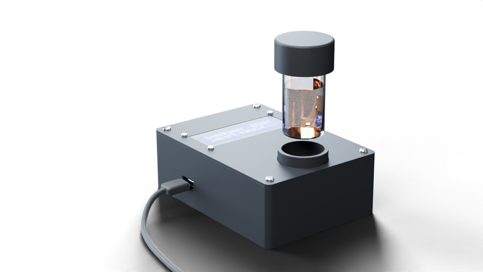

  

<h1 align="center">SuppBuddy</h1>

<b>The pocket lab for your supplements.</b>

<i>Built at the Cube Buildathon, November 2026</i>

  

## The problem

Supplements don't need FDA approval before they're sold. Between 2007 and 2016 the FDA found
**776 supplements with hidden drugs** in them (JAMA Network Open, 2018), and those are only the ones it
caught. Fillers and contamination are invisible to the eye, and a lab test costs far more than the bottle.

## What SuppBuddy does

Mix a scoop of your supplement into water, drop the vial into SuppBuddy, and tap **Start** on your phone.

1. **Measure:** the tester shines four colors of light through the sample and watches what passes through
   and what scatters.
2. **Compare:** the readings are checked against other people's scans of the same product, and the brand
   is checked against FDA and NIH records.
3. **Report:** you get a plain-language verdict on whether your powder looks like the real thing, written
   with Claude.

The tester plugs into the iPhone for power and talks to it over Bluetooth, so there's nothing else to carry.

  

## Team

- **[Akshay Karthik](https://www.linkedin.com/in/akshay-karthik-a219a7311/)**: iterated on the ESP32 firmware with Kevin to drive the LEDs and read the light sensors.
- **[William Chen](https://www.linkedin.com/in/chenwilliam2026/)**: developed the entire backend system.
- **[Kevin Yuan](https://www.linkedin.com/in/kevinyuan92620/)**: iterated on the ESP32 firmware with Akshay to drive the LEDs and read the light sensors.
- **[David Wang](https://www.linkedin.com/in/davidwang-/)**: built the whole iPhone app, connected it to the tester, and drove the tester's LCD.
- **[Trevor Bedson](https://bedson.tech)**: designed the CAD with James and manufactured the enclosure.
- **[James Nguyen](https://www.linkedin.com/in/jamesnguyen008/)**: designed the CAD with Trevor and manufactured the enclosure.

Inspired by Peel, the HackMIT-winning at-home medical testing device.

## Learn more

- **[Technical documentation](documentation.md):** how it works, the hardware, the science and how to run it.
- **[CAD model in Onshape](https://cad.onshape.com/documents/ada0757f8a367ed8c935f14f/w/389f688fe28c85a3add01f94/e/45284f49e09add42eb3ea0fc)**
- **Pitch deck:** [PDF](assets/SuppBuddy.pdf) · [PowerPoint](assets/SuppBuddy.pptx)

> SuppBuddy is a screening tool, not a certified lab test or medical advice.
