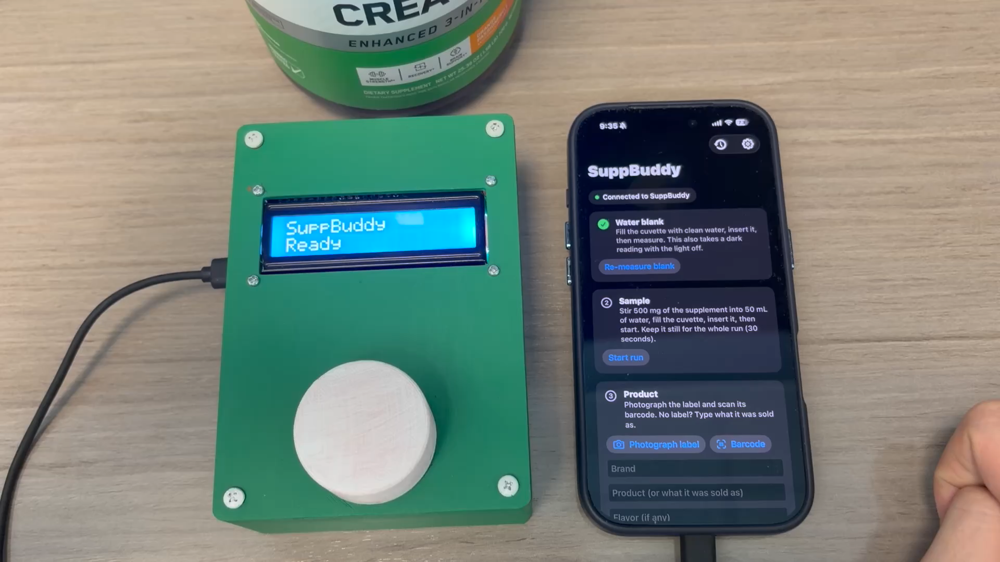
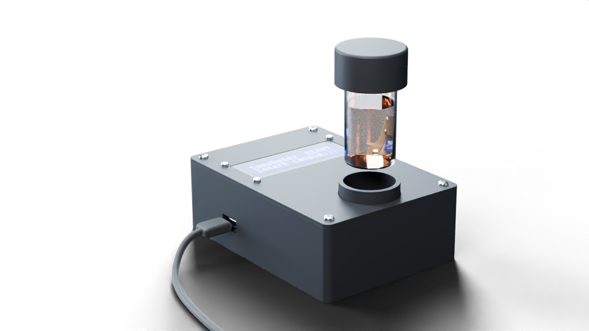
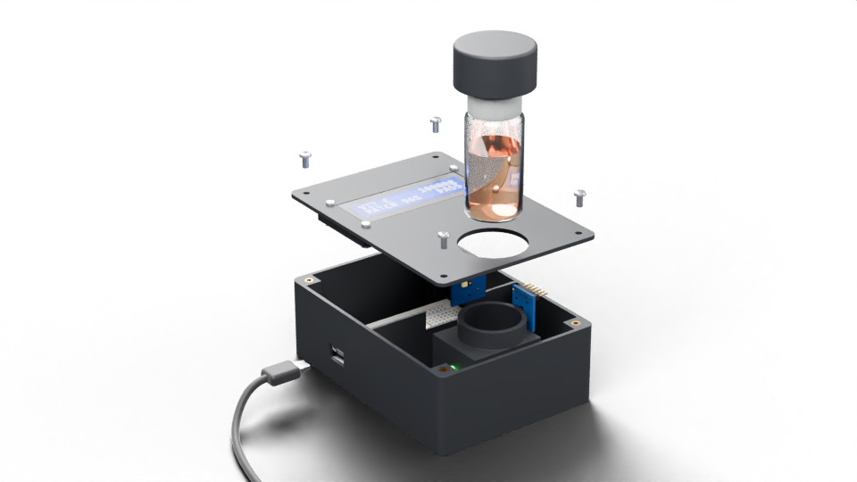
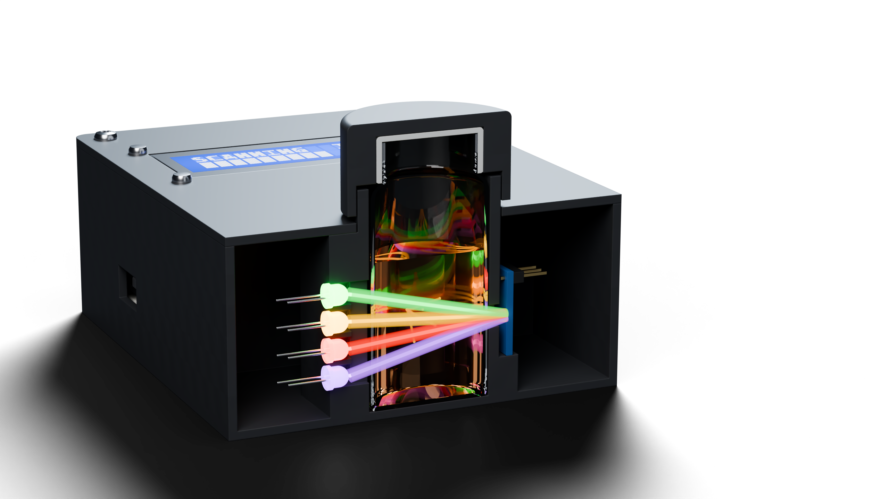
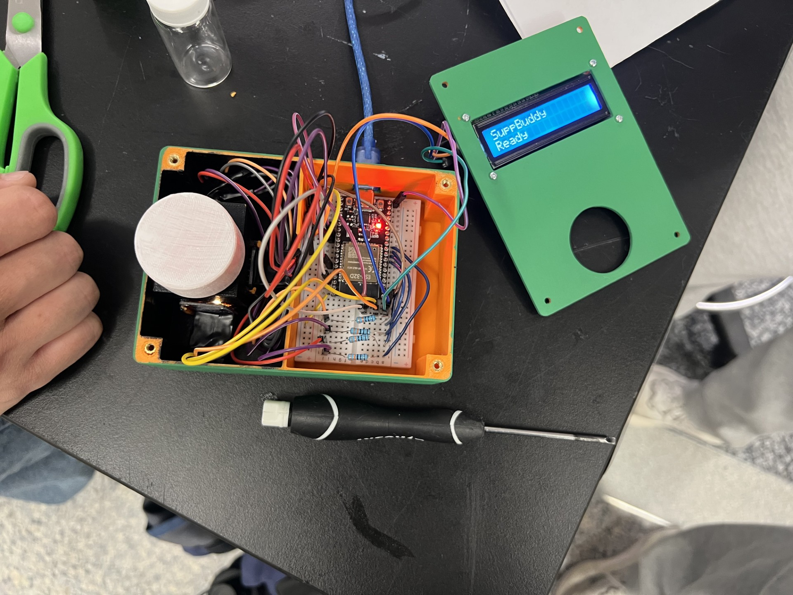
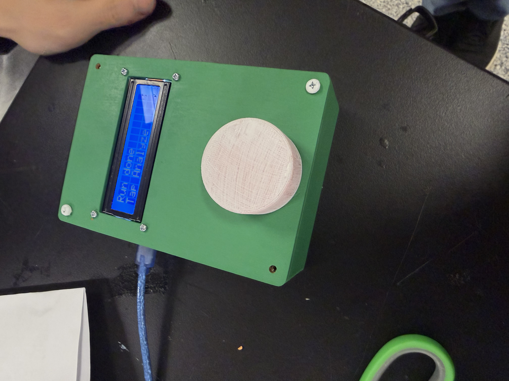
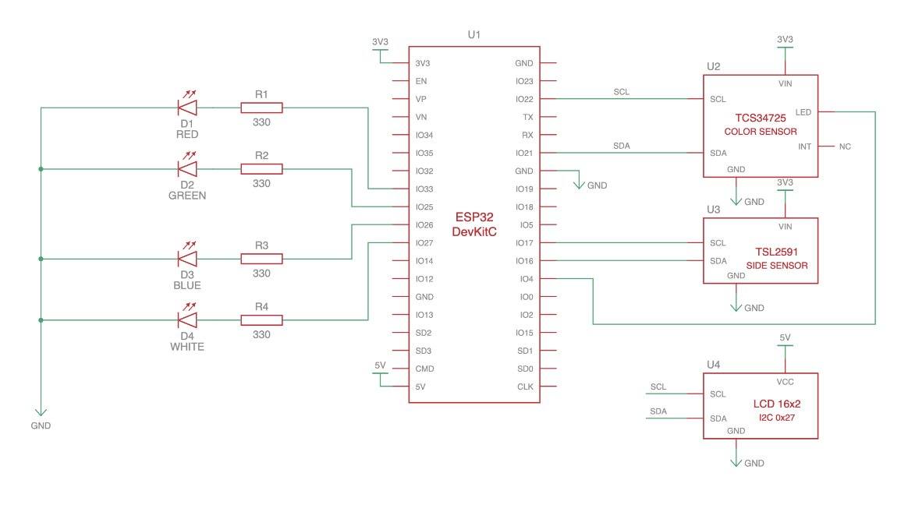

# SuppBuddy: Technical Documentation

**The pocket lab for your supplements.** Built at the Cube Buildathon, November 2026.

## Team

- **[Akshay Karthik](https://www.linkedin.com/in/akshay-karthik-a219a7311/)**: iterated on the ESP32 firmware with Kevin to drive the LEDs and read the light sensors.
- **[William Chen](https://www.linkedin.com/in/chenwilliam2026/)**: developed the entire backend system.
- **[Kevin Yuan](https://www.linkedin.com/in/kevinyuan92620/)**: iterated on the ESP32 firmware with Akshay to drive the LEDs and read the light sensors.
- **[David Wang](https://www.linkedin.com/in/davidwang-/)**: built the whole iPhone app, connected it to the tester, and drove the tester's LCD.
- **[Trevor Bedson](https://bedson.tech)**: designed the CAD with James and manufactured the enclosure.
- **[James Nguyen](https://www.linkedin.com/in/jamesnguyen008/)**: designed the CAD with Trevor and manufactured the enclosure.

## Overview

SuppBuddy is a hardware and software system that screens dietary supplements for fakes, fillers and
contamination at home. A small 3D-printed tester shines four colors of light through a dissolved sample and
measures how much light passes straight through (absorbance) and how much scatters sideways (turbidity). The
iPhone app collects those readings and a photo of the label. The backend compares the scan with other users'
scans of the same product and checks the brand against FDA and NIH records. Claude then explains the verdict in
plain language.

<p align="center">
  
</p>

## Inspiration

Supplements don't need FDA approval before they're sold, and they keep getting more popular. A JAMA Network
Open study (2018) found **776 supplements with hidden drugs** in FDA data from 2007 to 2016, and those are
only the ones the FDA caught. Fillers and contamination are invisible to the eye, and lab testing costs far
more than the product.

We were inspired by **Peel**, the HackMIT winner that brought medical testing home. SuppBuddy applies the same
"lab in your pocket" idea to supplements. Its backend also borrows Peel's design: a fast, deterministic report
first and the AI narrative second.

## Key Features

- **Four-color optical test:** white, red, green and blue LEDs, measured in under a minute
- **Turbidity and particle size:** a side sensor catches fillers like starch that don't dissolve
- **Crowdsourced fingerprints:** every confirmed scan improves the reference for that product
- **Public records:** FDA tainted-supplement list, recalls, adverse events and the NIH label database
- **Label reading:** photograph the label or scan the barcode
- **Plain-language report:** Claude explains the result. Code sets the verdict; the AI never does
- **Phone-powered:** the tester runs off the iPhone's USB-C port and talks to it over Bluetooth

## How It Works

1. **Blank:** fill the vial with clean water. The tester takes a dark reading and a reading under each LED.
2. **Sample:** stir 500 mg of the supplement into 50 mL of water, fill the vial and start the run. The
   tester cycles dark, white, red, green and blue readings about every 1.4 s while the app charts them live.
3. **Product:** photograph the label (read by Claude), scan the barcode (looked up in the NIH database) or
   type the product name.
4. **Analyze:** the backend extracts features, scores them and returns a verdict within seconds. Claude's
   explanation follows, and the result is shown on the tester's screen.
5. **Confirm:** "Yes, this is that product" adds the scan to the crowd reference, or holds it for review if it
   disagrees with an established reference.

## The Science

| Measurement | Physics | What it tells you |
|---|---|---|
| Spectral absorbance | Transmission through the sample (Beer–Lambert) | Each compound absorbs its own mix of wavelengths, which gives it a color fingerprint |
| Turbidity | Light scattered at 90° (nephelometry) | True solutions barely scatter; undissolved solids do, even after mixing |
| Particle size | Scatter under blue vs. red light | Fine particles scatter blue much more; coarse grains like starch scatter every color alike |

From those raw readings the backend computes:

```
A_c(t) = -log10( (I_c(t) - dark_c(t)) / (blank_c - dark_c) )   c ∈ {R, G, B}   in-line sensor
S(t)   = (scatter(t) - dark_s(t)) / (scatter_blank - dark_s)   1.0 = water      90° sensor
```

It also derives color ratios, final cloudiness, dissolving speed (t90), the share of cloudiness left at the
end, settling rate and scatter flicker. Dark readings during the run are interpolated and subtracted at each
reading's time, so changing room light doesn't count.

**Honest limits:** three color bands and one scatter channel can't identify a compound or measure a dose.
SuppBuddy detects **deviation from other scans of the same product**, which is why the crowd database matters
most. Reports say "consistent with N scans", never "verified".

## Hardware Design

### CAD Model

The enclosure was designed in Onshape over three iterations and printed in dark filament so that room light
can't reach the sensors.

<p align="center">
  
</p>

| Version | What changed |
|---|---|
| **V1** | A box built around a standard cuvette, with the LEDs and sensors around it |
| **V2** | Heat-set M3 inserts, a light seal around the LCD, a light wall between the electronics and the optics, and a rounded cap |
| **V3** | Switched to a 20 mL SKS vial with a printed cap sleeve. The LEDs sit in a vertical column so every beam crosses the vial's full diameter, and the sensors slide into dedicated pockets |

<p align="center">
  
  
</p>

V3 has three printed parts:

- **Base** (92 × 128.5 mm): an electronics bay for the breadboard and ESP32 with a USB-C opening, a light wall,
  and an optics block holding the vial bore, the LED column, and two sensor windows with slide-in board
  pockets (one in line with the beam and one at 90°). Four corner posts take M3 heat-set inserts.
- **Lid:** a 2 mm plate with a window for the 16×2 LCD and a light seal underneath it.
- **Cap sleeve:** presses onto the vial's white cap. When the vial is seated, its skirt hangs over a collar on
  the base and blocks out light. Lift the sleeve to pull the vial out.

The V3 model is a normal, fully dimensioned Onshape feature tree with variables for the fits and for the
sizes worth measuring before printing. **[Open the V3 CAD in Onshape](https://cad.onshape.com/documents/ada0757f8a367ed8c935f14f/w/389f688fe28c85a3add01f94/e/45284f49e09add42eb3ea0fc)**.
The same document also has the V1 and V2 Part Studios. Every dimension, iteration and part is documented in
[hardware/details.md](hardware/details.md), and the CAD scripts are in [hardware/cad/](hardware/cad/).

### Print It Yourself

Download the V3 STL files (millimetres, exported from Onshape):

| Part | File |
|---|---|
| All three parts | [suppbuddy-v3-stl.zip](hardware/stl/suppbuddy-v3-stl.zip) |
| Base | [suppbuddy-v3-base.stl](hardware/stl/suppbuddy-v3-base.stl) |
| Lid | [suppbuddy-v3-lid.stl](hardware/stl/suppbuddy-v3-lid.stl) |
| Vial cap sleeve | [suppbuddy-v3-sleeve.stl](hardware/stl/suppbuddy-v3-sleeve.stl) |

- Use **black or dark filament** so room light can't leak in. No supports are needed.
- Print the base floor-down, and the lid and sleeve upside down.
- Print the sleeve first and check its press fit on your vial's cap before printing the rest.
- The parts fit an SKS 20 mL PET vial (⌀27.4 mm body). For a different vial, change the fit variables in the
  Onshape model and re-export.

<p align="center">
  
  
</p>

### Electrical

<p align="center">
  
</p>

An ESP32 DevKit drives four LEDs, each through its own 330 Ω resistor, and reads two light sensors. Both
sensors use I²C address 0x29, so each gets its own I²C bus.

| Part | ESP32 pin | Notes |
|---|---|---|
| TCS34725 SDA / SCL | 21 / 22 | Color sensor, in line behind the vial (transmitted light). I²C bus 0 |
| TCS34725 LED pin | 4 | Held LOW by the firmware so the board's own white LED stays off |
| TSL2591 SDA / SCL | 16 / 17 | Light sensor at 90° to the beam (scattered light). I²C bus 1 |
| Both sensors VIN / GND | 3V3 / GND | |
| White / red / green / blue LED | 33 / 25 / 26 / 27 | GPIO → 330 Ω → LED → GND |
| 16×2 LCD | I²C, address 0x27, 5 V | Shows status and the verdict |

Pins are defined in `firmware/SupplementOpticalTester/Config.h`, and this table must match it. Use a
WROOM-based ESP32, because GPIO 16/17 are taken by PSRAM on WROVER modules. Power comes from the iPhone's
USB-C port. If the board stays dark on a USB-C to USB-C cable, use Apple's USB-C to USB adapter with a USB-A to
USB-C cable: some boards lack the resistors that tell a USB-C source to turn power on.

## Software Architecture

```
ESP32 tester ──BLE──► iPhone app ──HTTPS──► FastAPI backend ──► openFDA, NIH DSLD, tainted list
   (readings)          (label photo,          (features → scoring → verdict)
                        live chart)                    └──► Claude: label reading + explanation
```

| Stage | What it does | Needs network |
|---|---|---|
| Features | QC, absorbance per band, scatter, dissolving speed, noise | no |
| Product | Normalizes brand + name (or barcode) to a product ID | no |
| Deterministic scoring | Tainted list, openFDA recalls and adverse events, NIH label registry, crowd z-scores → verdict | yes (degrades gracefully) |
| Agent | A Claude tool loop writes the headline, summary and citations | yes (optional) |

- **Accuracy:** z-scores against the product's confirmed scans, using the worse of the RMS over all features
  and the largest single feature, so a filler that mostly changes cloudiness isn't averaged away. Products with
  fewer than 3 scans fall back to rough ingredient-class ranges.
- **Quality checks:** a scan is rejected for too few samples, a saturated channel, a dead LED, a light leak or
  a flat signal.
- **Crowd data:** only QC-passing, user-confirmed scans update a product's fingerprint. Products are keyed by
  barcode when there is one, otherwise by brand + name + flavor.

## Technology Stack

**Hardware:** ESP32-WROOM-32 DevKit, Adafruit TCS34725 RGB color sensor, TSL2591 light sensor, white/red/
green/blue LEDs, a 16×2 LCD, an SKS 20 mL PET vial, and a 3D-printed enclosure designed in Onshape.

**Software:**
- **App:** SwiftUI, iOS 17+, CoreBluetooth
- **Firmware:** Arduino C++ for the ESP32, with BLE (Nordic UART Service)
- **Backend:** Python, FastAPI, SQLite/Postgres
- **AI:** Claude API (label vision and the report agent)
- **Data:** openFDA, the NIH Dietary Supplement Label Database, and FDA's tainted supplements list
- **CI:** GitHub Actions runs the backend tests, the app self-check and both firmware builds

## Getting Started

### Backend

The backend holds the Claude API key; the app has no secrets.

```bash
cd backend/suppbuddy-backend
python3 -m venv .venv && .venv/bin/pip install -r requirements.txt
cp .env.example .env              # put ANTHROPIC_API_KEY in .env
.venv/bin/python -m scripts.seed_demo
.venv/bin/uvicorn app.main:app --host 0.0.0.0 --port 8000
```

### App

Open `SuppBuddy.xcodeproj` and run. In the Simulator the default server (`http://127.0.0.1:8000`) works, and a
simulated tester replays the backend's simulator (genuine and cornstarch-cut vitamin C, alternating). On an
iPhone, set your team under Signing & Capabilities. Then, in the app's Settings, enter the laptop's address on
the same Wi-Fi (`http://192.168.x.x:8000`) or an `ngrok http 8000` https address. After editing `project.yml`,
regenerate the project with `xcodegen generate`.

### Tester

Flash `firmware/SupplementOpticalTester` (Arduino IDE or `arduino-cli`, board `esp32:esp32:esp32`). Plug it into
the iPhone's USB-C port for power; the app finds it over Bluetooth. With no sensors wired, flash
`firmware/suppbuddy_stub` instead.

### Checks

CI runs the same commands:

```bash
swiftc SuppBuddy/Analysis.swift SuppBuddy/Server.swift SuppBuddy/NIH.swift checks/main.swift -o /tmp/suppbuddy-check && /tmp/suppbuddy-check
cd backend/suppbuddy-backend && .venv/bin/python -m pytest -q
```

### Sample prep (protocol v3)

**500 mg of powder in 50 mL of water (10 g/L), stirred, then poured into the vial.** Creatine only dissolves up
to about 17 g/L at 20 °C, so a stronger mix would leave genuine creatine cloudy. The app sends the amounts
(Settings → Sample prep), and the server rescales color and cloudiness when a scan used a different amount.

## BLE Protocol (v3)

Data goes over Bluetooth LE, because iOS apps can't read an ESP32's USB serial without Apple's MFi program.
The tester uses the Nordic UART Service `6E400001-B5A3-F393-E0A9-E50E24DCCA9E` and advertises as `SuppBuddy`.
The app writes commands to RX (`6E400002-…`), and the tester answers with `\n`-terminated lines on TX
(`6E400003-…`); `\r\n` also works. The same commands work typed into Arduino's Serial Monitor at 115200 baud.

| App writes | Tester answers |
|---|---|
| `b` | `I,…`, then `D,<values>` (all LEDs off), then `B,<led>,<values>` for each LED with clean water in the vial, then `E` |
| `s` | `I,…`, then about every 1.4 s a cycle of `K,<t_ms>,<values>` (dark) and `S,<t_ms>,<led>,<values>` for each LED, for 60 s, then `E` |
| `L\|line1\|line2` | Nothing; it shows the two lines on the tester's screen |

- `<values>` is `r,g,b,c,full,ir`: the TCS34725 counts (averaged over 3 integrations, one decimal), then the
  TSL2591's full-spectrum and infrared counts.
- `<led>` is `W`, `R`, `G` or `B`, in that order.
- `I,v3,<tcs gain>,<tcs ms>,<tsl gain>,<tsl ms>,WRGB` reports the sensor settings. The backend derives
  saturation limits from them and warns when they differ from the reference settings.
- `X,<message>` followed by `E` means the tester can't measure (for example, a sensor isn't detected); the app
  shows the message.
- The app gives up after 5 s without a line. Each line fits in one notification (MTU 185; lines are under 70
  bytes).

## Repository Layout

| Folder | What |
|---|---|
| `SuppBuddy/` | SwiftUI iPhone app |
| `backend/suppbuddy-backend/` | FastAPI server: features, scoring, crowd fingerprints, FDA/NIH lookups, Claude agent ([README](backend/suppbuddy-backend/README.md)) |
| `firmware/SupplementOpticalTester/` | Tester firmware ([README](firmware/SupplementOpticalTester/README.md)) |
| `firmware/suppbuddy_stub/` | Same protocol with fake readings, for testing the app on a bare ESP32 |
| `hardware/` | Enclosure CAD scripts, printable STLs (`hardware/stl/`), renders and the full hardware log ([details.md](hardware/details.md)) |
| `checks/` | App logic self-check, with real backend responses as fixtures |
| `assets/` | Wiring diagram, pitch deck (PPTX and PDF), and the photos used in these docs |

## Challenges

- **Light leaks:** small amounts of room light swamp the scatter signal. The enclosure got a light wall, an
  LCD light seal and finally a cap sleeve that covers the vial.
- **Round vials:** an off-axis beam crosses less sample than a centered one, so the LEDs moved into a vertical
  column on the vial's axis.
- **Two sensors, one address:** both sensors are fixed at I²C address 0x29, so each runs on its own I²C bus.
- **iPhone connectivity:** iOS can't open a USB serial device without MFi, so data goes over BLE while the
  iPhone's USB-C port supplies power.
- **API rate limits:** the Onshape API quota ran out mid-build, so the CAD moved to fewer, larger API calls.

## Known Shortcuts

- The crowd reference starts from simulated seed scans (`scripts/seed_demo.py`, marked synthetic). Replace
  them with about 5 real confirmed scans per product.
- `backend/suppbuddy-backend/data/tainted_supplements.csv` ships empty. Import FDA's list
  (`python -m scripts.import_tainted`), or the tainted check is skipped.
- Scoring thresholds and record weights are first guesses; `grep -rn "TODO(" backend` lists them.

## Future Development

- Calibrate thresholds on real scans across many products
- More wavelengths, including UV and IR, for sharper fingerprints
- A custom PCB in place of the breadboard, for a smaller tester
- Grow the crowd database, with lot-level tracking for recalls

## Acknowledgments

- The **Cube Buildathon** organizers and mentors
- **Peel** (HackMIT) for the inspiration
- **openFDA** and the **NIH Office of Dietary Supplements** for open data

---

*SuppBuddy is a screening tool, not a certified lab test or medical advice.*
